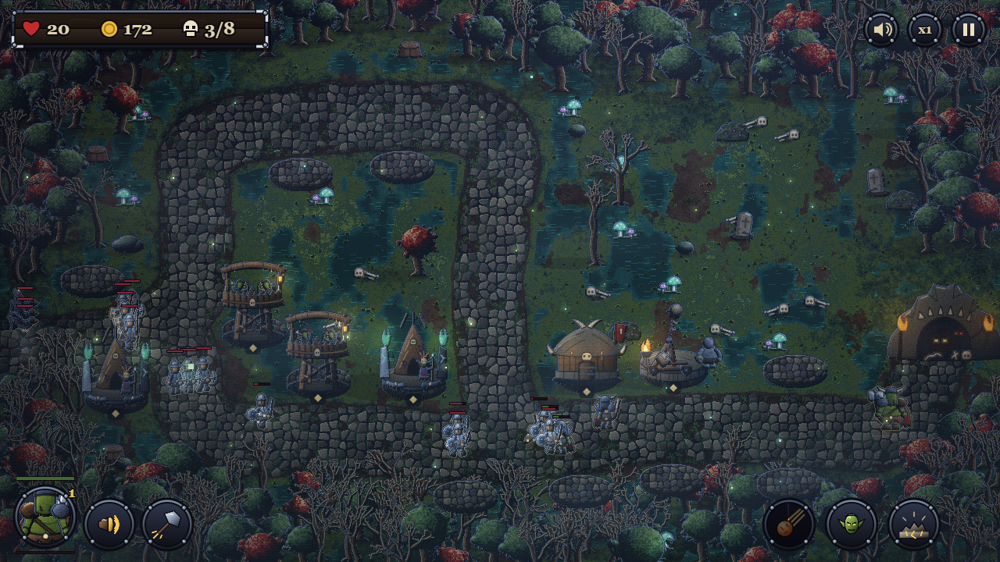
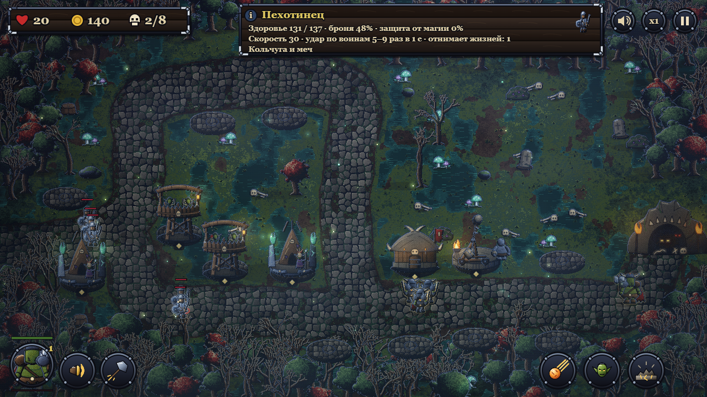
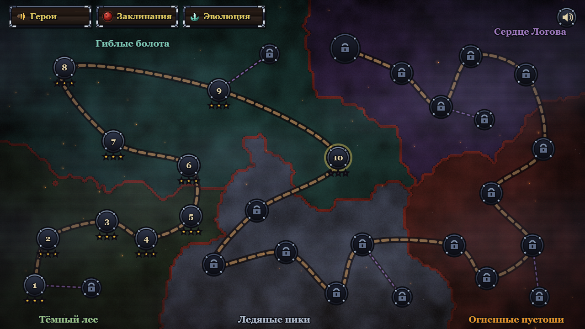
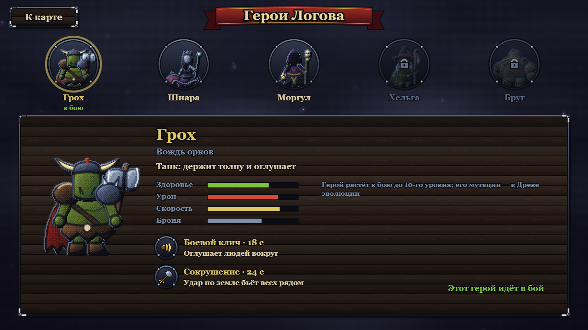
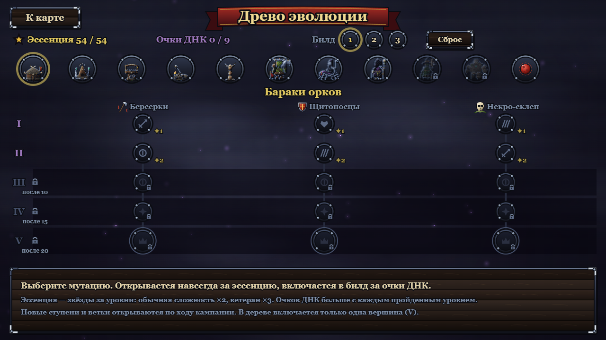

# Монстры в обороне

Tower defense наоборот: короли людей собрали армию — крестьяне с вилами, рыцари в латах, конница, грифоны и сам Король идут на логово монстров, а вы строите башни орков, гоблинов и троллей и не пропускаете их к пещере.

Браузерная игра для Яндекс Игр: компьютер, планшет и телефон (горизонтально). **Это витрина проекта** — исходный код закрыт, пока игра готовится к выпуску. Ссылка на игру появится здесь после публикации.

## Что внутри

- 30 уровней в пяти землях — Тёмный лес, Гиблые болота, Ледяные пики, Огненные пустоши и Сердце Логова — плюс 5 испытаний
- 5 видов башен, у каждой 3 эволюции и свои умения — 15 форм
- 5 героев-монстров: вождь орков, королева пауков, некромант, болотная ведьма и каменный голем
- 10 заклинаний, в бой берёте любые три
- 33 вида врагов: летающие, быстрые, бронированные, лекари и великаны
- Древо эволюции на 200 мутаций — свой билд перед боем
- 3 сложности и звёзды за каждый уровень

## Скриншоты

| | |
|---|---|
|  |  |
| Бой: башни у дороги, герой, заклинания | Карта: пять земель и испытания |
|  |  |
| Герои-монстры и их умения | Древо эволюции на 200 мутаций |

## Как сделано

- Чистый JavaScript без фреймворков и зависимостей, рендер на Canvas — около 4 800 строк кода
- Своя сборка в архив под Яндекс Игры и локальный сервер для разработки (Node.js), тесты на встроенном `node --test`
- Интеграция с SDK Яндекс Игр: облачные сохранения, реклама между боями и за награду, пауза игры и звука при рекламе и сворачивании вкладки
- Адаптация под телефон: управление касанием, подсказка повернуть экран, без выделения текста и прокрутки

Графика и звук сделаны автором, в том числе с помощью нейросетей.

## Автор

[@grozeser](https://github.com/grozeser)
